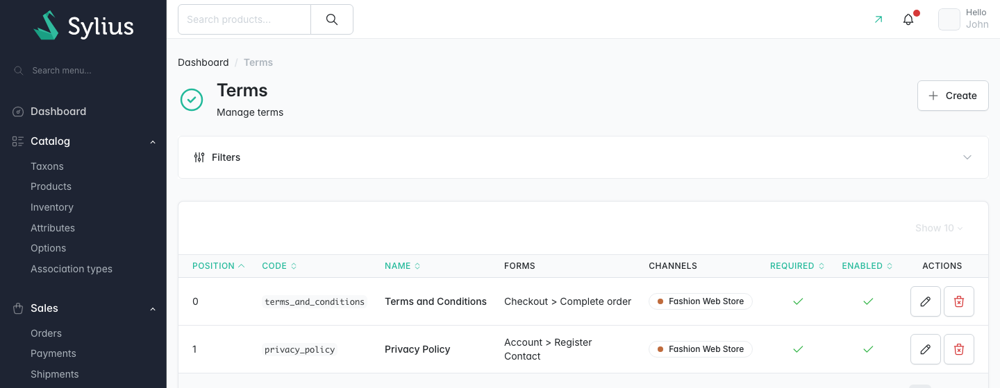
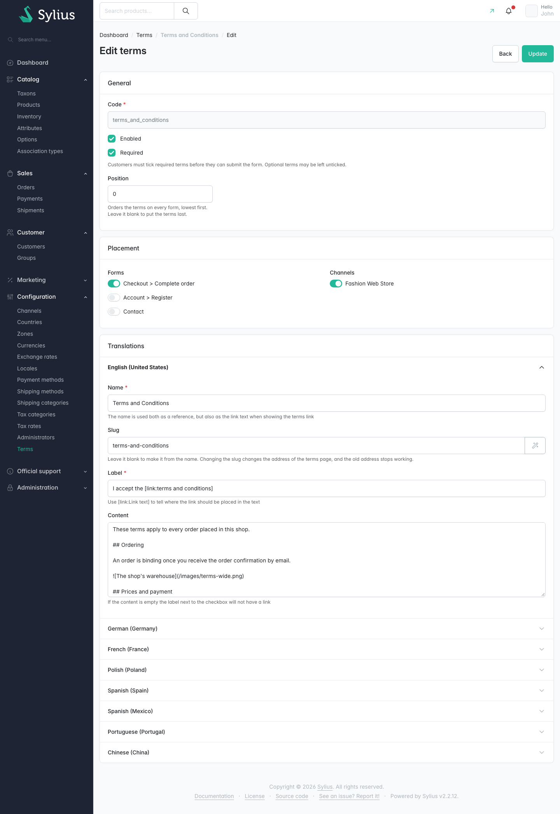
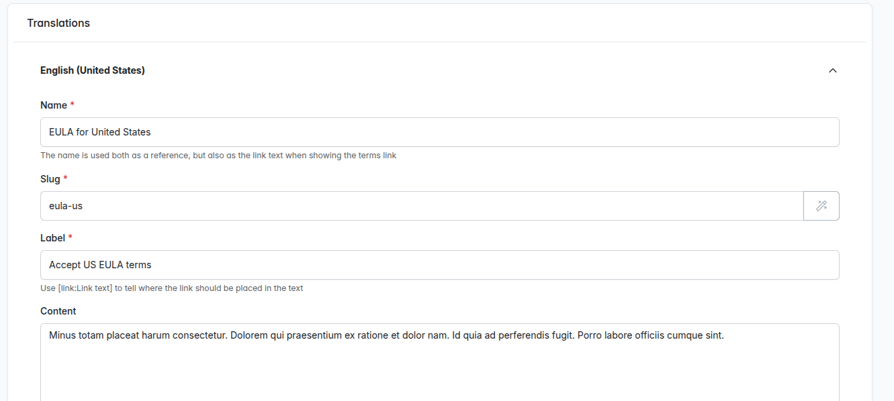

# Sylius terms and conditions plugin

[![Latest Version][ico-version]][link-packagist]
[![Software License][ico-license]](LICENSE)
[![Build Status][ico-github-actions]][link-github-actions]
[![Code Coverage][ico-code-coverage]][link-code-coverage]

Will add a checkbox to the selects form(s) where the customer has to accept the terms and conditions before continuing.

This can be used to make sure the customer has accepted the terms and conditions before placing an order.

* [Screenshots](#screenshots)
* [Terms versions](#terms-versions)
* [Installation](#installation)

## Screenshots

### Shop

Before the customer can place order, he/she has to check the required terms


### Admin

Here is a list of terms. Notice the `terms_and_conditions` which is associated with multiple channels.



Notice that you select the form where the terms are shown. As default only the `Checkout > Complete` form is available,
but you can add more in the `setono_sylius_terms.forms` configuration option.



The `Label` field is the text shown on the complete order page. Notice you can use a placeholder (`[link:Link text]`) to tell where the link should be.



## Terms versions

Every Terms keeps a history of versions. A version is a numbered snapshot of the Terms' name, label and content in
every locale, for example "Version 3, in force since 16 November 2026". Versions can't be edited: a flush that changes
a saved version throws a `LogicException`.

* Every save that changes the name, label or content in any locale, or adds or removes a translation, creates the
  next version. Creating a Terms creates version 1. This holds for every save, whether it comes from the admin,
  the fixture or your own code.
* The slug, code, channels, Forms and the enabled flag aren't versioned. Changing only those creates no version.
* A version is in force from the moment it is saved until the next version is saved. The plugin reads "now" from
  Symfony Clock.

To find out which version of a Terms was in force at a given moment in a given locale, for example what a customer
accepted when their checkout completed, ask the Terms version repository:

```php
/** @var \Setono\SyliusTermsPlugin\Repository\TermsVersionRepositoryInterface $termsVersionRepository */
$termsVersionRepository = $container->get('setono_sylius_terms.repository.terms_version');

$translation = $termsVersionRepository->findOneInForce($terms, $order->getCheckoutCompletedAt(), $order->getLocaleCode());

$translation?->getVersion()->getNumber(); // 3
$translation?->getContent();              // the content in the order's locale, as entered
```

It returns `null` when the moment is before the Terms' first version, or when the version in force has no translation
in that locale. There is no fallback to another locale.

### Limitations

* **Placement isn't versioned.** The lookup can name a version for an order whose checkout never showed that Terms,
  for example a Terms added to checkout after the order. Callers judge relevance from the current placement.
* **Mid-checkout race.** If an admin saves a new version between a customer loading checkout complete and submitting
  it, the order is inferred to have accepted the new version. Forms carry no version check.
* **Deleting a Terms deletes its versions.** To retire a Terms and keep its history, disable it instead.

## Installation

The plugin requires PHP 8.2 or later, Symfony 6.4 or 7.4 and Sylius 2.2 or later. For Sylius 1, use the `2.x` versions of the plugin.
When upgrading from 2.x, read [UPGRADE.md](UPGRADE.md).

### Step 1: Download the plugin

```bash
composer require setono/sylius-terms-plugin
```

### Step 2: Enable the plugin

Then, enable the plugin by adding it to the list of registered plugins/bundles
in the `config/bundles.php` file of your project:

```php
<?php
# config/bundles.php
return [
    // ...
    
    Setono\SyliusTermsPlugin\SetonoSyliusTermsPlugin::class => ['all' => true],
    
    // It is important to add plugin before the grid bundle
    Sylius\Bundle\GridBundle\SyliusGridBundle::class => ['all' => true],
    
    // ...
];
```

**NOTE** that you must instantiate the plugin before the grid bundle, else you will see an exception like `You have requested a non-existent parameter "setono_sylius_terms.model.terms.class".`

### Step 3: Import routing

```yaml
# config/routes/setono_sylius_terms.yaml

setono_sylius_terms:
    resource: "@SetonoSyliusTermsPlugin/config/routes.yaml"
```

There's also a version for non-localized stores: `@SetonoSyliusTermsPlugin/config/routes_no_locale.yaml`

### Step 4: Update your database schema

```bash
$ php bin/console doctrine:migrations:diff
$ php bin/console doctrine:migrations:migrate
```

### Step 5: Override checkout complete form

Override the [Sylius Form](https://github.com/Sylius/Sylius/blob/master/src/Sylius/Bundle/ShopBundle/Resources/views/Checkout/Complete/_form.html.twig):

* If you haven't your own `templates/bundles/SyliusShopBundle/Checkout/Complete/_form.html.twig` yet:

    ```bash
    $ cp vendor/sylius/sylius/src/Sylius/Bundle/ShopBundle/Resources/views/Checkout/Complete/_form.html.twig \
    templates/bundles/SyliusShopBundle/Checkout/Complete/_form.html.twig
    ```

* If you already have it:

    Add terms field (exactly this conditional way):

    ```twig
    {# templates/bundles/SyliusShopBundle/Checkout/Complete/_form.html.twig #}
    
        {{ form_row(form.terms) }}
    
    ```

    So the final template will look like this:

    ```twig
    {# templates/bundles/SyliusShopBundle/Checkout/Complete/_form.html.twig #}
    {{ form_row(form.notes, {'attr': {'rows': 3}}) }}
    
        {{ form_row(form.terms) }}
    
    ```

# Troubleshooting

* If you see `Neither the property "terms" nor one of the methods "terms()", "getterms()"/"isterms()"/"hasterms()" or "__call()" exist and have public access in class "Symfony\Component\Form\FormView".`

    Then see https://github.com/Setono/SyliusTermsPlugin/issues/13
    and double-check you added terms field at template like described
    at `Override checkout complete form` section.
    
* If you see `Grid "setono_sylius_terms_terms" does not exists`

    Then you forgot to import config from `Step 3: Import config` section.

[ico-version]: https://poser.pugx.org/setono/sylius-terms-plugin/v/stable
[ico-license]: https://poser.pugx.org/setono/sylius-terms-plugin/license
[ico-github-actions]: https://github.com/Setono/SyliusTermsPlugin/workflows/build/badge.svg
[ico-code-coverage]: https://codecov.io/gh/Setono/SyliusTermsPlugin/graph/badge.svg

[link-packagist]: https://packagist.org/packages/setono/sylius-terms-plugin
[link-github-actions]: https://github.com/Setono/SyliusTermsPlugin/actions
[link-code-coverage]: https://codecov.io/gh/Setono/SyliusTermsPlugin
