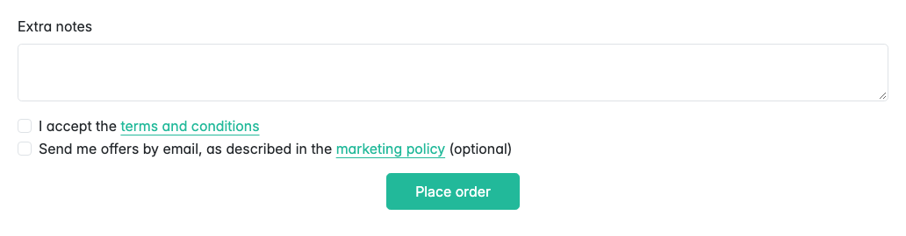
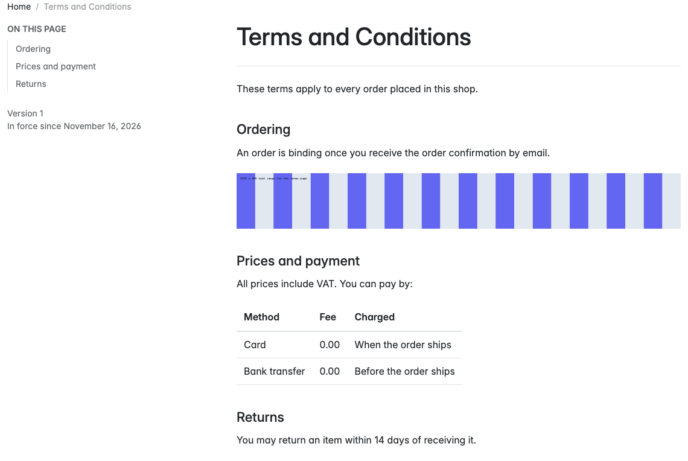
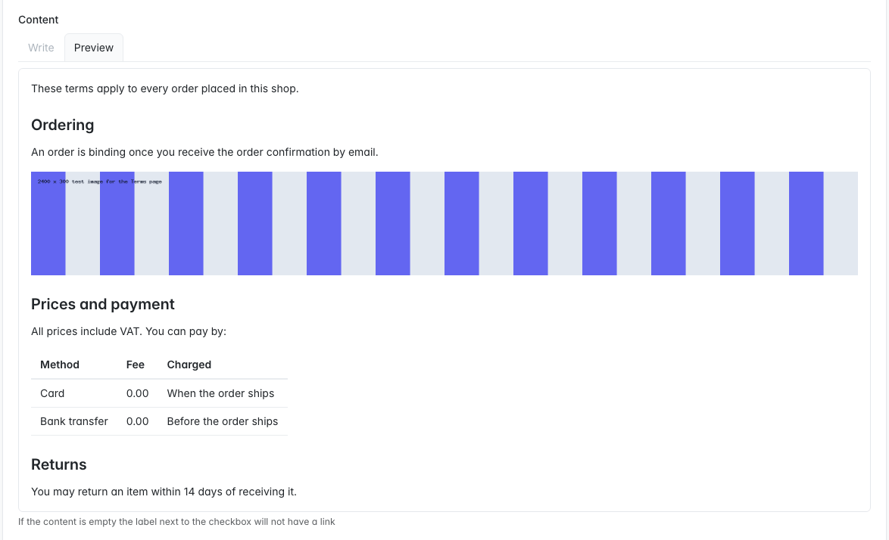
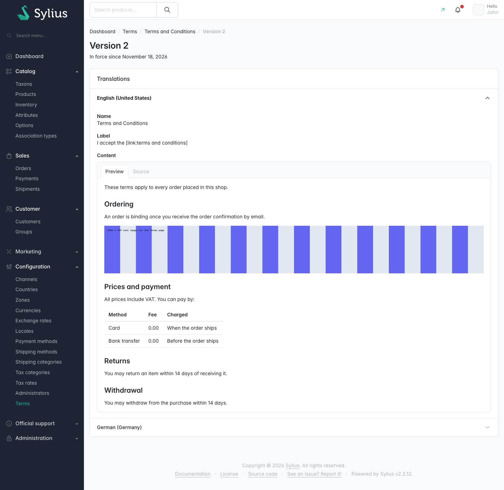

# Sylius terms and conditions plugin

[![Latest Version][ico-version]][link-packagist]
[![Software License][ico-license]](LICENSE)
[![Build Status][ico-github-actions]][link-github-actions]
[![Code Coverage][ico-code-coverage]][link-code-coverage]

Adds terms checkboxes to shop forms, such as checkout complete, registration and contact, and a shop page per Terms.
The customer has to tick the required terms before the form can be submitted, for example before placing an order.

* [Screenshots](#screenshots)
* [Admin](#admin)
* [Forms](#forms)
* [Terms checkboxes](#terms-checkboxes)
* [Required and optional terms, and position](#required-and-optional-terms-and-position)
* [Finding and checking the Terms on a Form in code](#finding-and-checking-the-terms-on-a-form-in-code)
* [Reacting to Answers](#reacting-to-answers)
* [Content](#content)
* [Terms versions](#terms-versions)
* [Terms pages](#terms-pages)
* [Terms in the order confirmation email](#terms-in-the-order-confirmation-email)
* [Fixtures](#fixtures)
* [Installation](#installation)

## Screenshots

### Shop

Before the customer can place the order, they have to tick the required terms



Each Terms has its own page, with a table of contents and the Terms version in force (see [Terms pages](#terms-pages))



### Admin


The Preview tab of the content shows it as the Terms page renders it, unsaved edits included (see [Writing Content](#writing-content))





## Admin

Terms are under **Configuration > Terms**. The index lists every Terms in position order, with the Forms and channels
it is placed on and whether it is required and enabled. Search it by code or name, or filter it by enabled.

The form has three cards:

* **General:** the code, enabled, required and position. A new Terms is required. Leave the position blank to put the
  Terms last (see [Required and optional terms, and position](#required-and-optional-terms-and-position)).
* **Placement:** the [Forms](#forms) the Terms shows on, each listed by its label, and the channels.
* **Translations:** the name, slug, label and content in each locale. The `Label` is the text next to the checkbox. Use
  a Link placeholder (`[link:Link text]`) to tell where the link to the Terms page goes. The content is Markdown, with a
  toolbar and a preview (see [Writing Content](#writing-content)).

The wand button next to a slug makes the slug from the name in that locale. A slug left blank is made from the name
when the Terms is saved. Slugs stay editable: changing one changes the address of the Terms page, and the old address
stops working.

A Terms can be placed on a Form code that isn't configured, for example after you remove a Form from
`setono_sylius_terms.forms`. The admin shows such a code as an extra, ticked choice labelled `<code> (not configured)`,
and the index flags it the same way. The shop ignores it, and it stays on the Terms until an admin unticks it and
saves.

### Writing Content

The content of each locale is [Markdown](#content), written in a textarea with a toolbar above it. Its buttons insert a
heading, bold, italic, a quote, a link, an image, a bulleted list and a numbered list, around the selected text or at
the cursor. They insert through the browser's editing commands, so undo and redo work as they do for typing.

* The heading button inserts `## `, a second-level heading, because the Terms page shows the Terms' name as its `<h1>`.
  The `##` headings make up the page's table of contents.
* Images are inserted by URL; there is no upload. Select the image's alt text and click the image button to get
  `` with `url` selected, then type or paste the image's URL. If you select a URL instead, it goes in
  place of `url`.

The **Preview** tab shows the content as the Terms page renders it, sanitised, including edits that aren't saved yet.
The server renders it, through the same `ContentRendererInterface` as the Terms page, each time the form re-renders,
for example when you click the tab.

The toolbar is GitHub's [`<markdown-toolbar>` element](https://github.com/github/markdown-toolbar-element) 2.2.3. The
plugin ships its prebuilt file, with its MIT license, in `public/admin/markdown-toolbar-element-2.2.3/`, and loads it as
a module script on the Terms create and update pages only. Your app needs no npm install and no rebuild:
`assets:install` copies it to your `public/` directory along with the other bundles' assets.

### Version history

Below the form, the update page lists the Terms' [versions](#terms-versions), newest first, with the number, the
moment each was in force from and the locales it has text in. Each opens a read-only page that shows the version's
name, label and content in each locale, for example under "Version 3, In force since November 16, 2026". The content
has two tabs: **Preview**, the content rendered as the Terms page renders it, and **Source**, the Markdown as it was
saved. There is no diff between versions and no record of who saved one.

Deleting a Terms also deletes its versions. To keep a Terms' history, disable the Terms instead of deleting it.

### View in store

Like Sylius' product page, the update page has a **View in store** button that opens the [Terms page](#terms-pages). A
Terms in several channels gets a dropdown with one entry per enabled channel. Each entry links to the page in the
channel's default locale, on the channel's hostname, and is disabled exactly when that page is not found. The button is
disabled when the Terms is disabled or in no enabled channel.

The links come from `terms_channel_path(terms, channel)`, which returns the path of the Terms page in the channel's
default locale, or `null` when there is no page there.

### Changing the admin

The pages are Sylius' CRUD pages, and their hooks are under `setono_sylius_terms.admin.terms`:

| Hook                                                                                        | Hookables                                 |
|---------------------------------------------------------------------------------------------|-------------------------------------------|
| `setono_sylius_terms.admin.terms.{create,update}.content.form`                              | `general`, `placement`, `translations`    |
| `setono_sylius_terms.admin.terms.{create,update}.content.form.general`                      | `code`, `enabled`, `required`, `position` |
| `setono_sylius_terms.admin.terms.{create,update}.content.form.placement`                    | `forms`, `channels`                       |
| `setono_sylius_terms.admin.terms.{create,update}.content.form.translations`                 | `name`, `slug`, `label`, `content`        |
| `setono_sylius_terms.admin.terms.{create,update}.content.form.translations.content#write`   | `toolbar`, above the textarea             |
| `setono_sylius_terms.admin.terms.{create,update}.content.form.translations.content#preview` | `preview`, the Write and Preview tabs     |
| `setono_sylius_terms.admin.terms.{create,update}#javascripts`                               | `markdown_toolbar`, the toolbar's script  |
| `setono_sylius_terms.admin.terms.{create,update}#stylesheets`                               | `terms_content`, the preview's stylesheet |
| `setono_sylius_terms.admin.terms.update.content`                                            | `versions`, below core's `form`           |
| `setono_sylius_terms.admin.terms.update.content.header.title_block.actions`                 | `view_in_store`, before core's buttons    |

The form is the Live Component `setono_sylius_terms:admin:terms:form`
(`Setono\SyliusTermsPlugin\Twig\Component\TermsFormComponent`). The Versions card is outside it.

The content editor's three parts, `toolbar`, `preview` and `markdown_toolbar`, are separate hookables, so you can
disable or replace each one. The `toolbar` and `preview` hookables get the locale's translation form as `form`, and
`locale`. Without `preview` there are no tabs, and the textarea shows on its own. The Write tab shows the element whose
id is the textarea's id followed by `-write`, so a replacement `preview` has to keep pointing there.

The read-only version page, `setono_sylius_terms_admin_terms_version_show` at
`/%sylius_admin.path_name%/terms/{id}/versions/{number}`, is Sylius' CRUD show page, with its hooks under
`setono_sylius_terms.admin.terms_version`. Its hookables get the version as `resource`, and the hookables of each
locale also get `translation` and `locale`:

| Hook                                                                          | Hookables                    |
|-------------------------------------------------------------------------------|------------------------------|
| `setono_sylius_terms.admin.terms_version.show.content`                        | `sections`                   |
| `setono_sylius_terms.admin.terms_version.show.content.sections`               | `translations`               |
| `setono_sylius_terms.admin.terms_version.show.content.sections.translations`  | `name`, `label`, `content`   |
| `setono_sylius_terms.admin.terms_version.show#stylesheets`                    | `terms_content`              |

The `terms_content` hookable loads a small stylesheet for the rendered content in the Preview tabs.

The index is the PHP grid `setono_sylius_terms_terms`. Change it with a grid mutator:

```php
use Sylius\Component\Grid\Attribute\AsGridMutator;
use Sylius\Component\Grid\Builder\GridBuilderInterface;
use Sylius\Component\Grid\Mutator\GridMutatorInterface;

#[AsGridMutator(grid: 'setono_sylius_terms_terms')]
final class TermsGridMutator implements GridMutatorInterface
{
    public function __invoke(GridBuilderInterface $gridBuilder): void
    {
        $gridBuilder->removeField('channels');
    }
}
```

Slugs are made by `Setono\SyliusTermsPlugin\Generator\SlugGeneratorInterface`, which uses Symfony's slugger. Decorate
or replace it to make slugs another way.

### Recipe: swapping in a WYSIWYG HTML editor

To write Content with an HTML editor instead of the Markdown toolbar:

1. Add a form type extension on `TermsTranslationType` that re-adds `content` with the editor's form type:

    ```php
    use Setono\SyliusTermsPlugin\Form\Type\TermsTranslationType;
    use Symfony\Component\Form\AbstractTypeExtension;
    use Symfony\Component\Form\FormBuilderInterface;

    final class TermsTranslationTypeExtension extends AbstractTypeExtension
    {
        public function buildForm(FormBuilderInterface $builder, array $options): void
        {
            $builder->add('content', YourEditorType::class, [
                'required' => false,
                'label' => 'setono_sylius_terms.form.terms.content',
                'help' => 'setono_sylius_terms.form.terms.content_help',
            ]);
        }

        public static function getExtendedTypes(): iterable
        {
            return [TermsTranslationType::class];
        }
    }
    ```

   The form is a Live Component that re-renders when a field changes. If the editor keeps its HTML in a hidden field,
   it has to fire a bubbling `change` event on that field when it writes to it, or a re-render brings back the old
   value.

2. Disable the three hookables, on both pages:

    ```yaml
    # config/packages/sylius_twig_hooks.yaml
    sylius_twig_hooks:
        hooks:
            'setono_sylius_terms.admin.terms.create.content.form.translations.content#write':
                toolbar: { enabled: false }
            'setono_sylius_terms.admin.terms.update.content.form.translations.content#write':
                toolbar: { enabled: false }
            'setono_sylius_terms.admin.terms.create.content.form.translations.content#preview':
                preview: { enabled: false }
            'setono_sylius_terms.admin.terms.update.content.form.translations.content#preview':
                preview: { enabled: false }
            'setono_sylius_terms.admin.terms.create#javascripts':
                markdown_toolbar: { enabled: false }
            'setono_sylius_terms.admin.terms.update#javascripts':
                markdown_toolbar: { enabled: false }
    ```

   Load the editor's own script from a hookable of your own on the same `#javascripts` hooks.

3. Either keep the default `ContentRendererInterface` or replace it. Markdown allows raw HTML, and the default renderer
   sanitises HTML input as it sanitises Markdown, so the editor's HTML renders as it is, minus what the sanitiser
   removes (see [Content](#content)). To render the HTML another way, replace the renderer (see
   [Replacing or decorating the renderer](#replacing-or-decorating-the-renderer)).

## Forms

A Form is a shop form that Terms can be placed on. Each Form is configured under a short code, and a Terms stores the
codes of the Forms it is placed on. Three Forms are available out of the box:

| Code                | Form type                                                     | Hook                                               |
|---------------------|---------------------------------------------------------------|----------------------------------------------------|
| `checkout_complete` | `Sylius\Bundle\CoreBundle\Form\Type\Checkout\CompleteType`    | `sylius_shop.checkout.complete.content.form`       |
| `registration`      | `Sylius\Bundle\ShopBundle\Form\Type\CustomerRegistrationType` | `sylius_shop.account.register.content.form`        |
| `contact`           | `Sylius\Bundle\CoreBundle\Form\Type\ContactType`              | `sylius_shop.contact.contact_request.content.form` |

Each is hooked at priority 50, just before the submit button. The admin picks which Terms appear on each Form.

### Adding a Form

Your entries add to the three defaults:

```yaml
# config/packages/setono_sylius_terms.yaml
setono_sylius_terms:
    forms:
        newsletter:
            type: App\Form\Type\NewsletterType           # required: the form type the Terms checkboxes are added to
            label: app.form.newsletter                     # optional: what the admin shows for the Form
            hooks: { app.newsletter.form: 50 }             # the Twig hooks the checkboxes render in, with their priority
            saved_event: app.newsletter.post_subscribe     # optional: the event dispatched once the form's data is saved
```

* Set `hooks: []` to render the checkboxes yourself (see [Rendering the checkboxes by hand](#rendering-the-checkboxes-by-hand)).
* The Form's Answers are dispatched after its `saved_event`, or right after a valid submit without one (see
  [Answers on your own Forms](#answers-on-your-own-forms)).
* Without a `label`, the admin shows the translation key `setono_sylius_terms.form.terms.term_form.<code>`.
* Each Form needs its own form type, because the plugin finds a Form by the type of the form being built. Two enabled
  Forms with the same type fail the container build. To reuse a default Form's type under your own code, switch the
  default off.

### Changing or switching off a default Form

An entry with a default Form's code changes only the keys it sets, and `enabled: false` switches a default Form off:

```yaml
setono_sylius_terms:
    forms:
        checkout_complete:
            hooks: { app.checkout.complete.terms: 10 } # keeps its type and saved event
        contact:
            enabled: false
```

Terms placed on a Form that you switch off keep its code, which the admin shows as "contact (not configured)". They
are no longer shown, enforced or attached to the order confirmation email for that Form.

## Terms checkboxes

When a Form's form type is built in the shop, the plugin adds a `terms` field to it, with one checkbox per Terms the
[Form lookup](#finding-and-checking-the-terms-on-a-form-in-code) finds for the Form in the current channel and locale,
now. A Form with no Terms there gets no `terms` field and renders nothing. The checkboxes are in position order, and
each is named by its Terms' code, such as `sylius_checkout_complete[terms][terms_and_conditions]`.

Each checkbox shows the Label of the Terms version in force. The Label is plain text: HTML in it is escaped and shows as
text. Its Link placeholder (`[link:Link text]`) becomes a link to the Terms page, and a Label without one links as a
whole. When the Terms has no content, nothing links, and a Link placeholder shows just its link text.

### How the checkboxes reach a Form

You don't need to change any template. For each hook of each Form, the plugin adds the hookable
`setono_sylius_terms_checkboxes` at the hook's priority. All of them render
`@SetonoSyliusTermsPlugin/shop/form/terms.html.twig`, which renders the checkboxes of the form in the hook's context
(`hookable_metadata.context.form`), if it has a `terms` field. Change or switch off a hookable in your own config:

```yaml
# config/packages/sylius_twig_hooks.yaml
sylius_twig_hooks:
    hooks:
        'sylius_shop.contact.contact_request.content.form':
            setono_sylius_terms_checkboxes:
                template: 'shop/contact/terms.html.twig' # your own template, or enabled: false to switch it off
```

To move the checkboxes to another hook, change the Form's `hooks` (see [Forms](#forms)) rather than the hookable.

### Rendering the checkboxes by hand

A Form with `hooks: []` gets no hookable. Render its `terms` field in your own template, and keep the guard, since the
field is missing when the Form has no Terms:

```twig

    {{ form_row(form.terms) }}

```

## Required and optional terms, and position

* **Required terms** must be ticked before the form they are on can be submitted. **Optional terms** may be left
  unticked. A Terms is required by default, and the flag applies on every Form it is placed on: a Terms that must be
  required on one Form and optional on another becomes two Terms.
* **Position** orders the Terms on every Form, lowest first. A Terms saved without a position goes last. Setting a
  position moves the Terms there and shifts the Terms from there on one place down. Changing the position or the
  required flag doesn't create a [Terms version](#terms-versions).

### How required terms show and are enforced

* A required Terms' checkbox renders with Symfony's `required: true`, which adds the HTML `required` attribute and the
  shop theme's `required` class. An optional Terms' checkbox has neither. The plugin adds no marker of its own, so
  write it into the Label if your customers should see which Terms are optional, for example "(optional)".
* Sylius' shop forms are `novalidate`, so the browser doesn't stop the submit: the server enforces required terms. A
  required Terms left unticked fails the form, with the error on its checkbox ("You must accept the terms to
  continue."). Checkout complete places no order until it is ticked.
* The `terms` field validates in its own validation group, `setono_sylius_terms_checkboxes`, with the
  `RequiredTermsTicked` constraint. Symfony resolves a field's own groups before its form's, so required terms are
  enforced whatever validation groups the Form uses, or none, as on the contact form.
* The check reads the Terms on the Form at submit time. If an admin saves a new version in between, the customer
  accepts the new version (see [Limitations](#limitations)).

## Finding and checking the Terms on a Form in code

Both services work without a request or a Symfony form, so you can use them from a command, an email or an API.

The Form lookup returns the Terms version in force for each enabled Terms placed on a Form in a channel, read in a
locale, in position order. It skips a Terms that has no version in force at that moment, or no translation in that
locale:

```php
/** @var \Setono\SyliusTermsPlugin\Lookup\FormTermsLookupInterface $formTermsLookup */
$translations = $formTermsLookup->lookup('checkout_complete', $order->getChannel(), $order->getLocaleCode(), $order->getCheckoutCompletedAt());

foreach ($translations as $translation) {
    $translation->getVersion()->getTerms()->getCode(); // terms_and_conditions
    $translation->getVersion()->getNumber();           // 3
    $translation->getLabel();                          // the label of that version, in the order's locale
}
```

The moment defaults to now. The placement (enabled, channels and Forms) is always the current one. A Form that isn't
enabled in the `forms` config has no Terms, even if Terms placed on it before still list its code.

The required terms checker returns the required Terms on a Form that the customer left unticked, given the codes of
the ticked Terms:

```php
/** @var \Setono\SyliusTermsPlugin\Checker\RequiredTermsCheckerInterface $requiredTermsChecker */
$unticked = $requiredTermsChecker->getUntickedRequiredTerms('checkout_complete', $channel, 'en_US', ['terms_and_conditions']);
```

The `RequiredTermsTicked` constraint wraps the checker for the current channel and locale, so a DTO can carry it. The
value is the list of the ticked Terms' codes, and each unticked required Terms raises a violation at `[<Terms code>]`:

```php
use Setono\SyliusTermsPlugin\Validator\Constraints\RequiredTermsTicked;

final class CompleteCheckoutCommand
{
    /** @var list<string> */
    #[RequiredTermsTicked(form: 'checkout_complete')]
    public array $terms = [];
}
```

## Reacting to Answers

An Answer is whether the customer ticked a Terms checkbox when submitting a Form. The plugin doesn't store Answers. It
hands them to you in one event, `Setono\SyliusTermsPlugin\Event\TermsAnsweredEvent`, so you can keep your own record,
such as a consent log. The event is dispatched once per valid submit of a Form that shows Terms, after the Form's work
is saved:

| Form                | Dispatched                                                                       | `data`                         |
|---------------------|----------------------------------------------------------------------------------|--------------------------------|
| `checkout_complete` | after `sylius.order.post_complete`, once the completed order is saved            | the `Order`                    |
| `registration`      | after `sylius.customer.post_register`, once the customer is saved and has an ID  | the `Customer`                 |
| `contact`           | right after the valid submit, since the contact form saves nothing               | the submitted values, an array |

* Until the Form's save, the Answers wait. When the save doesn't come, nothing is dispatched. For example, Sylius'
  `OrderIntegrityChecker` stops a checkout on `sylius.order.pre_complete` when a promotion no longer applies or the
  total has changed. The customer submits again, and that submit's Answers are dispatched once the order completes.
* An invalid submit dispatches nothing, and neither does a Live Component re-render, such as the registration form's.

```php
use Setono\SyliusTermsPlugin\Event\TermsAnsweredEvent;
use Symfony\Component\EventDispatcher\Attribute\AsEventListener;

#[AsEventListener]
final class RecordConsentListener
{
    public function __invoke(TermsAnsweredEvent $event): void
    {
        $event->form;       // the Form's code, such as checkout_complete
        $event->data;       // the form's data, see the table above
        $event->channel;    // the channel the Terms were shown in
        $event->localeCode; // the locale they were shown in

        foreach ($event->answers as $answer) {
            $answer->version->getTerms()->getCode(); // terms_and_conditions
            $answer->version->getNumber();           // 3
            $answer->ticked;                         // true or false
        }
    }
}
```

* `answers` holds one Answer per Terms shown, in the order shown. Its `version` is the
  [Terms version](#terms-versions) shown, the one in force when the form was built. Its text in the locale shown is
  `$answer->version->getTranslation($event->localeCode)`.
* A required Terms is always ticked, since the Form can't be submitted without it. Only an optional Terms can be
  unticked.
* Your listener runs after Sylius has flushed the Form's data, so changes you make to the order or customer aren't part
  of Sylius' save. Flush what you change yourself.
* The plugin listens to the saved event at priority -100, after Sylius' own listeners there, such as the order
  confirmation email and the registration email. They have run by the time your listener does, so a listener of yours
  that throws can't stop them. The reverse holds too: when one of them throws, for example because the email can't be
  sent through a synchronous mailer transport, the request fails after the order or customer is saved, and that save's
  Answers are never dispatched. A consent log that must not miss an order shouldn't rely on the event alone.

### Answers on your own Forms

A Form you add (see [Adding a Form](#adding-a-form)) gets the after-save guarantee only if its config names a
`saved_event`: the event your code dispatches once the form's data is saved. Without one, its Answers are dispatched
right after its valid submit, before your code has saved anything.

```yaml
# config/packages/setono_sylius_terms.yaml
setono_sylius_terms:
    forms:
        newsletter:
            type: App\Form\Type\NewsletterType
            hooks: { app.newsletter.form: 50 }
            saved_event: app.newsletter.post_subscribe
```

* Dispatch the saved event in the request that submitted the form. Answers that are still waiting when the request
  ends are dropped. The event's object can be anything.
* The Answers come from the root form, so the Form's type must be the type of the form you submit. A Form nested inside
  another form dispatches nothing.
* A Live Component re-renders its form by submitting it, so in a Live Component request a valid submit can't be told
  from a re-render. A Form without a `saved_event` dispatches nothing there. If a LiveAction saves your Form, give the
  Form a `saved_event` and dispatch it in the action.

### Dispatching Answers from your own code

To pass on Answers that don't come through a Symfony form, such as from an API, hand them to
`Setono\SyliusTermsPlugin\Dispatcher\TermsAnsweredDispatcherInterface`. It applies the same rule: the event waits for the
Form's `saved_event` in the same request, or is dispatched right away for a Form without one.

```php
use Setono\SyliusTermsPlugin\Event\Answer;
use Setono\SyliusTermsPlugin\Event\TermsAnsweredEvent;

$termsAnsweredDispatcher->dispatch(new TermsAnsweredEvent('checkout_complete', $order, $channel, 'en_US', [
    new Answer($termsVersion, ticked: true),
]));
```

## Content

The Content of a Terms is Markdown ([CommonMark](https://commonmark.org/) plus GitHub's tables and autolinks) that
allows raw HTML, so Content written as HTML works too. Every rendering of Content is sanitised: scripts, event
handlers, unsafe URLs and `class` and `style` attributes are removed. Admins write it with a Markdown toolbar and a
preview (see [Writing Content](#writing-content)).

Print Content with the `terms_content` filter, never with `|raw`:

```twig
{{ terms.content|terms_content }}
```

Headings render at the level they are written at. Markdown headings get an `id`: `## Payment` becomes
`<h2 id="content-payment">`, and a second `## Payment` gets `content-payment-1`. `##` headings also end in a `#`
permalink to themselves, and they make up the outline (see below). Headings written as raw HTML, such as
`<h2>Payment</h2>`, get no id and aren't in the outline.

### Rendering Content in code

`ContentRendererInterface` returns the sanitised HTML and the outline of the `##` headings, both from the same parse:

```php
/** @var \Setono\SyliusTermsPlugin\Renderer\ContentRendererInterface $contentRenderer */
$rendered = $contentRenderer->render($translation->getContent() ?? '');

$rendered->html; // sanitised, safe to print

foreach ($rendered->outline as $heading) {
    $heading->id;   // content-payment, so link to it with "#content-payment"
    $heading->text; // Payment, as plain text
}
```

### Loosening or tightening the sanitiser

Content goes through the `setono_sylius_terms.content` sanitizer of
[Symfony's HTML sanitizer](https://symfony.com/doc/current/html_sanitizer.html), which the plugin configures and
enables. It allows:

* the elements and attributes the sanitizer considers safe, which include every element Markdown produces, tables
  included, but not `class` or `style`
* links with an `http`, `https`, `mailto`, `tel` or relative URL
* images with an `http`, `https` or relative `src`
* `id` on `h1`–`h6` only
* input of any length

Your own config for the sanitizer is merged into the plugin's:

```yaml
# config/packages/html_sanitizer.yaml
framework:
    html_sanitizer:
        sanitizers:
            setono_sylius_terms.content:
                allowed_link_schemes: ['sms'] # also allow sms: links
                force_https_urls: true        # rewrite http:// links and images to https://
                drop_elements: ['img']        # remove images
```

Lists such as `allowed_link_schemes` add to the plugin's entries and can't remove them. To allow `id` on other
elements than headings, add
`without_attribute_sanitizers: ['Setono\SyliusTermsPlugin\Sanitizer\HeadingIdAttributeSanitizer']`.

### Replacing or decorating the renderer

Every place that shows Content renders it through `Setono\SyliusTermsPlugin\Renderer\ContentRendererInterface`.
Decorate it to change the output, or replace it to render Content another way. **A replacement has to sanitise its
output itself**, because the `terms_content` filter prints what it returns unescaped.

```php
use Setono\SyliusTermsPlugin\Renderer\ContentRendererInterface;
use Setono\SyliusTermsPlugin\Renderer\RenderedContent;
use Symfony\Component\DependencyInjection\Attribute\AsDecorator;

#[AsDecorator(ContentRendererInterface::class)]
final class ResponsiveTablesContentRenderer implements ContentRendererInterface
{
    public function __construct(private readonly ContentRendererInterface $decorated)
    {
    }

    public function render(string $content): RenderedContent
    {
        $rendered = $this->decorated->render($content);

        // The decorated renderer has sanitised the HTML already, so the class added here stays
        $html = str_replace(['<table>', '</table>'], ['<div class="table-responsive"><table>', '</table></div>'], $rendered->html);

        return new RenderedContent($html, $rendered->outline);
    }
}
```

## Terms versions

Every Terms keeps a history of versions. A version is a numbered snapshot of the Terms' name, label and content in
every locale, for example "Version 3, in force since 16 November 2026". Versions can't be edited: a flush that changes
a saved version throws a `LogicException`.

* Every save that changes the name, label or content in any locale, or adds or removes a translation, creates the
  next version. Creating a Terms creates version 1. This holds for every save, whether it comes from the admin,
  the fixture or your own code.
* The slug, code, channels, Forms, position and the enabled and required flags aren't versioned. Changing only those
  creates no version.
* A version is in force from the moment it is saved until the next version is saved. The plugin reads "now" from
  Symfony Clock.
* A Terms upgraded from 2.x gets version 1 from `setono:sylius-terms:upgrade-from-2x`, in force from the moment the
  command runs. Orders completed before then have no inferred version (see [UPGRADE.md](UPGRADE.md#upgrade-steps)).

Admins see the versions of a Terms on its update page and open each one read-only (see
[Version history](#version-history)).

To find out which version of a Terms was in force at a given moment in a given locale, for example what a customer
accepted when their checkout completed, ask the Terms version repository:

```php
/** @var \Setono\SyliusTermsPlugin\Repository\TermsVersionRepositoryInterface $termsVersionRepository */
$termsVersionRepository = $container->get('setono_sylius_terms.repository.terms_version');

$translation = $termsVersionRepository->findOneInForce($terms, $order->getCheckoutCompletedAt(), $order->getLocaleCode());

$translation?->getVersion()->getNumber(); // 3
$translation?->getContent();              // the content in the order's locale, as entered
```

It returns `null` when the moment is before the Terms' first version, or when the version in force has no translation
in that locale. There is no fallback to another locale.

### Limitations

* **Placement isn't versioned.** The lookup can name a version for an order whose checkout never showed that Terms,
  for example a Terms added to checkout after the order. Callers judge relevance from the current placement.
* **Mid-checkout race.** If an admin saves a new version between a customer loading checkout complete and submitting
  it, the order is inferred to have accepted the new version. Forms carry no version check.
* **Deleting a Terms deletes its versions.** To retire a Terms and keep its history, disable it instead.

## Terms pages

Every Terms has its own page in the shop, at `/{_locale}/terms/{slug}`, such as `/en_US/terms/terms-and-conditions`.
The slug is set per locale, and the `terms` part of the path is the `routing.terms` option (see
[Step 3: Import routing](#step-3-import-routing)). These addresses stay the same as long as the slug does, so link to
them from your footer, your emails or anywhere else the customer should be able to read the terms. To find a Terms'
address, use the [View in store](#view-in-store) button on its admin update page, or generate it with
[`terms_path()`](#linking-to-a-terms-page).

The page shows the Terms version in force: its name, its Content, and its number and the date it has been in force
since, such as "Version 3, In force since November 16, 2026", with the date in the customer's locale. When the Content
has at least two `##` headings, a table of contents lists them. From the `lg` breakpoint up, it sits in a sidebar left
of the content that stays in view while the customer scrolls. Below that, it is a collapsed "On this page" above the
content. The page needs no JavaScript, and printing it prints the name and the content only.

The page is not found when the Terms is disabled, isn't in the current channel, has no translation in the current
locale, has no version in force, or the version in force has no Content in the current locale. There are no pages for
past versions.

### Linking to a Terms page

Two Twig functions take a Terms code and use the current channel and locale:

```twig
{# The path of the Terms page, such as /en_US/terms/terms-and-conditions #}
<a href="{{ terms_path('terms_and_conditions') }}">Read our terms</a>

{# <a href="/en_US/terms/terms-and-conditions" class="nav-link">Terms and Conditions</a> #}
{{ terms_link('terms_and_conditions', {class: 'nav-link'}) }}
```

`terms_link()` takes the `<a>`'s HTML attributes, escapes them, and uses the name of the Terms version in force as the
link text. A passed `href` is ignored, so the link always points at the Terms page. Both functions return nothing,
`null` and an empty string, in exactly the cases where the Terms page is not found, so a link never leads to a missing
page. Guard your own markup with ``.

To change the markup of `terms_link()`, override `@SetonoSyliusTermsPlugin/shop/terms/link.html.twig` in
`templates/bundles/SetonoSyliusTermsPlugin/shop/terms/link.html.twig`. It gets `path`, `terms`, `translation` (the
Terms version in force) and `attributes`.

### Adding the links to Sylius' footer

The plugin adds nothing to the footer, which belongs to your app. If your shop keeps Sylius' default footer, point its
placeholder Terms and Conditions and Privacy Policy links at your Terms pages:

```yaml
# config/packages/sylius_twig_hooks.yaml
sylius_twig_hooks:
    hooks:
        'sylius_shop.base.footer.content.menu.informational_links':
            terms_and_conditions:
                template: 'shop/footer/terms_and_conditions.html.twig'
            privacy_policy:
                template: 'shop/footer/privacy_policy.html.twig'
```

```twig
{# templates/shop/footer/terms_and_conditions.html.twig #}
{{ terms_link('terms_and_conditions', {class: 'nav-link'}) }}
```

```twig
{# templates/shop/footer/privacy_policy.html.twig #}
{{ terms_link('privacy_policy', {class: 'nav-link'}) }}
```

Use the codes of your own Terms. A link whose Terms has no page in the channel and locale renders nothing.

### Changing the page

The page renders through Twig hooks. Each hookable's template is under `@SetonoSyliusTermsPlugin/shop/terms/show/`, at
the path of its hook and name, such as `shop/terms/show/content/main/name.html.twig`:

| Hook | Hookables, by priority |
|------|------------------------|
| `setono_sylius_terms.shop.terms.show` | `content` |
| `setono_sylius_terms.shop.terms.show.content` | `header` (200), `sidebar` (100), `main` (0) |
| `setono_sylius_terms.shop.terms.show.content.header` | `breadcrumbs` |
| `setono_sylius_terms.shop.terms.show.content.sidebar` | `table_of_contents` (100), `version` (0) |
| `setono_sylius_terms.shop.terms.show.content.main` | `name` (100), `content` (0) |

Every hookable gets `terms`, `version` (the Terms version in force), `translation` (the version's name and Content in
the current locale) and `rendered_content` (the `RenderedContent`, see [Rendering Content in code](#rendering-content-in-code))
in `hookable_metadata.context`.

The page's hook prefix is `setono_sylius_terms.shop.terms.show`, so the layout's hooks with that prefix, such as
`setono_sylius_terms.shop.terms.show#stylesheets`, apply to Terms pages only. The plugin's `terms_page` hookable there
links the stylesheet that styles the Content, `bundles/setonosyliustermsplugin/shop/terms-page.css`, which
`assets:install` copies to your `public/` directory along with the other bundles' assets. Rendered Content has no
`class` or `style` attributes, so the stylesheet styles it by element, scoped to the content wrapper. To style it
yourself, switch the hookable off with `enabled: false` and add your own.

#### Changing the page of one Terms

The page renders the hook of the Terms' code, `setono_sylius_terms.shop.terms.show.<code>`, before the generic hook,
and Twig hooks merges the two. On that one page, a hookable in the code's hook adds to the generic hookables, overrides
the generic hookable of the same name, or, with `enabled: false`, hides it. The nested hooks follow the same pattern:

```yaml
# config/packages/sylius_twig_hooks.yaml
sylius_twig_hooks:
    hooks:
        # A notice between the name and the content, on the page of terms_and_conditions only
        'setono_sylius_terms.shop.terms.show.terms_and_conditions.content.main':
            notice:
                template: 'shop/terms/notice.html.twig'
                priority: 50

        # No version in the sidebar, on the page of privacy_policy only
        'setono_sylius_terms.shop.terms.show.privacy_policy.content.sidebar':
            version:
                enabled: false
```

The code `content` is reserved, and saving a Terms with it fails validation: its hook would be the generic
`setono_sylius_terms.shop.terms.show.content`, and its page would render the header, sidebar and main twice.

## Terms in the order confirmation email

When you switch it on, the order confirmation email carries one Terms PDF for each required Terms on the checkout
complete Form, in position order. Each PDF holds the Terms version that was in force when checkout completed, in the
order's locale. This covers the email sent when checkout completes, in the shop or through the API, and the one an
admin resends from the order page. The email's body stays as it is.

A Terms PDF holds the version's name, a line such as "Version 3, in force since 16 November 2026" in the order's
locale, and the Content. It holds no order data, so one PDF serves every order that accepted the version. Its file name
is the version's name, slugified, plus the version number, such as `handelsbetingelser-v3.pdf`.

### Switching it on

The feature is off by default, and its PDF tooling is suggested, not required. Install it and register
`SyliusPdfGenerationBundle`:

```bash
composer require sylius/pdf-generation-bundle dompdf/dompdf symfony/http-client
```

```php
# config/bundles.php
return [
    // ...
    Sylius\PdfGenerationBundle\SyliusPdfGenerationBundle::class => ['all' => true],
];
```

```yaml
# config/packages/setono_sylius_terms.yaml
setono_sylius_terms:
    order_confirmation_email:
        pdf: true
```

With the switch on and the bundle or the HTTP client missing, the container build fails with the `composer require`
command above. The feature installs only where `sylius/pdf-generation-bundle` can: Symfony 6.4, or 7.4 and later.

The PDFs are attached when Sylius sends the email through its default `symfony_mailer` adapter. Their bytes travel
inside the message, so email sent asynchronously through Messenger needs no shared files.

### Which Terms are attached

- Only required Terms. Optional terms are never attached: the plugin doesn't store Answers, so the email can't know
  whether the customer ticked one.
- The Terms that are placed on checkout complete, enabled and in the order's channel when the email is sent. Placement
  and the required flag aren't versioned, so an admin resend after a placement change can attach other Terms than the
  first email did. The text in each PDF is still the version in force when checkout completed.
- A Terms with no version in force when checkout completed, or none in the order's locale, is skipped. That includes
  every order completed before `setono:sylius-terms:upgrade-from-2x` ran, because a Terms upgraded from 2.x gets
  version 1 when the command runs. Resending the confirmation of such an order attaches no PDFs.

### When a PDF can't be generated

The PDFs are generated while the email is sent, which by default is inside the checkout request. If one can't be
generated, the plugin logs an error with the order number and the Terms code, attaches the other PDFs and sends the
email. Checkout never fails over a PDF.

### Mentioning the attachments in the email

The plugin leaves the email's body as it is. To tell customers about the PDFs, override the template that renders the
content of both the first and the resent confirmation, include the original, and add your own text:

```twig
{# templates/bundles/SyliusCoreBundle/Email/Blocks/OrderConfirmation/_content.html.twig #}


<div style="text-align: center; margin-top: 30px;">
    {{ 'app.email.order_confirmation.terms_attached'|trans({}, null, localeCode) }}
</div>
```

The body is rendered before the PDFs are attached, so it can't tell whether any were. Word the text so that it also
holds for an order with no PDFs, such as one completed before the upgrade.

### Setting the channel hostname

Relative link and image URLs in the Content, such as `/en_US/contact`, are made absolute against the channel's
hostname, which you set on the channel in the admin. Without a hostname they stay relative, so links don't work in the
PDF and relative images don't show. Sylius' own email links need the hostname too, since Sylius 2.2.12 / 2.3.2.

The URLs use `https` only when `SYLIUS_UNSECURED_URLS` is `false`, as Sylius' own email links do. Sylius defaults it to
`yes`, which gives `http`.

### Images

The PDF engine downloads nothing. Before rendering, the plugin downloads each `http` and `https` image itself, with
Symfony's HTTP client, and inlines it as a `data:` URI. An image is downloaded only if it answers within 5 seconds with
an `image/*` response of at most 5 MB.

An image that can't be downloaded is replaced by its alt text, and an error naming the image URL, the Terms code and
the order number is logged. The PDF is still attached, because the text is intact, but it isn't cached, so the next
order's email tries the image again. A PDF's images download in parallel, so while an image host is down, each PDF
waits at most about 5 seconds for them.

### Changing the PDF engine

The PDFs render in the `setono_sylius_terms` context of `sylius/pdf-generation-bundle`, which the plugin sets to the
`dompdf` adapter. To render them with Gotenberg or wkhtmltopdf instead, install the adapter's package and switch the
context in your own config:

```yaml
# config/packages/sylius_pdf_generation.yaml
sylius_pdf_generation:
    contexts:
        setono_sylius_terms:
            adapter: gotenberg # or knp_snappy
```

### Overriding the PDF template

The PDF is rendered from `@SetonoSyliusTermsPlugin/pdf/terms.html.twig`, on A4 paper in the DejaVu Sans font, which
dompdf bundles and which covers far more characters than its core fonts. To change it, for example for Letter paper,
copy the template to `templates/bundles/SetonoSyliusTermsPlugin/pdf/terms.html.twig` and change `@page { size: A4; }`
to `@page { size: letter; }`. The template gets the `version`, its `translation` in the locale, the `locale_code` and
the `channel`. Pass `locale_code` to every `trans` and `format_date`, since the PDF isn't in the request's locale.

The PDFs are cached (see below), so clear the cache after changing the template:

```bash
bin/console cache:pool:clear setono_sylius_terms.pdf
```

### Caching

The PDF bytes go in the `setono_sylius_terms.pdf` cache pool, keyed by Terms version, locale and channel. The channel
is part of the key because of the absolute URLs. Only the first PDF of a version in a locale and channel is rendered.
The pool uses `cache.app`. To point it at another adapter:

```yaml
# config/packages/cache.yaml
framework:
    cache:
        pools:
            setono_sylius_terms.pdf:
                adapter: cache.adapter.redis
```

### Generating a Terms PDF in code

```php
/** @var \Setono\SyliusTermsPlugin\Pdf\TermsPdfGeneratorInterface $termsPdfGenerator */
$pdf = $termsPdfGenerator->generate($translation->getVersion(), $order->getLocaleCode(), $order->getChannel());

$pdf->content;  // the PDF bytes
$pdf->fileName; // handelsbetingelser-v3.pdf
$pdf->complete; // false when an image couldn't be downloaded
```

## Fixtures

The plugin ships the `setono_terms` fixture, but no fixture suite. Add Terms to your own suite:

```yaml
# config/packages/sylius_fixtures.yaml
sylius_fixtures:
    suites:
        default:
            fixtures:
                setono_terms:
                    options:
                        custom:
                            terms_and_conditions:
                                code: terms_and_conditions
                                forms: [checkout_complete]     # Form codes. Default: no Form
                                channels: [FASHION_WEB]        # channel codes. Default: every channel
                                locales: [en_US, de_DE]        # Default: every locale
                                required: true                 # Default: true
                                enabled: true                  # Default: true
                                position: 0                    # Default: last
                                name: Terms and Conditions
                                slug: terms-and-conditions     # Default: made from the name
                                label: I accept the [link:terms and conditions]
                                content: |
                                    ## Ordering

                                    An order is binding once you receive the order confirmation.
                                translations:
                                    de_DE:
                                        name: Allgemeine Geschäftsbedingungen
                                        slug: allgemeine-geschaeftsbedingungen
                                        label: Ich akzeptiere die [link:Allgemeinen Geschäftsbedingungen]
```

* `name`, `slug`, `label` and `content` apply to every locale in `locales`. `translations` overrides them per locale,
  and a locale in `translations` that isn't in `locales` is added.
* A Form code that isn't configured fails the fixture load.
* Left out, the code, name, label and content are faked. The faked label holds a Link placeholder, and the faked
  content is Markdown with two `##` sections.
* Loading the fixture saves the Terms like any other save, so each Terms gets version 1, in force from the moment it
  is loaded. A Terms with the same code is updated instead, which creates its next version if its text changed.

## Installation

The plugin requires PHP 8.2 or later, Symfony 6.4 or 7.4 and Sylius 2.2 or later. For Sylius 1, use the `2.x` versions of the plugin.
When upgrading from 2.x, read [UPGRADE.md](UPGRADE.md).

### Step 1: Download the plugin

```bash
composer require setono/sylius-terms-plugin
```

### Step 2: Enable the plugin

Then, enable the plugin by adding it to the list of registered plugins/bundles
in the `config/bundles.php` file of your project:

```php
<?php
# config/bundles.php
return [
    // ...
    Setono\SyliusTermsPlugin\SetonoSyliusTermsPlugin::class => ['all' => true],
];
```

The Terms page and the Terms PDF format dates with `format_date` from `twig/intl-extra`, which the plugin requires. The
plugin doesn't register its Twig extension, because Twig fails when an extension is registered twice, and Sylius' own
shop and admin templates need it as well. So a Sylius app already registers it, as Sylius-Standard does in
`config/packages/twig.yaml`. If yours doesn't, register it there:

```yaml
# config/packages/twig.yaml
services:
    Twig\Extra\Intl\IntlExtension: ~
```

### Step 3: Import routing

```yaml
# config/routes/setono_sylius_terms.yaml
setono_sylius_terms:
    resource: "@SetonoSyliusTermsPlugin/config/routes.yaml"
```

If your store's URLs have no locale prefix, import the non-localised version instead:

```yaml
# config/routes/setono_sylius_terms.yaml
setono_sylius_terms:
    resource: "@SetonoSyliusTermsPlugin/config/routes_no_locale.yaml"
```

Both mount the admin pages under `/%sylius_admin.path_name%` and the Terms page at `/{_locale}/terms/{slug}` and
`/terms/{slug}` respectively. To use your own prefixes, import `@SetonoSyliusTermsPlugin/config/routes/shop.yaml` and
`@SetonoSyliusTermsPlugin/config/routes/admin.yaml` separately.

The `terms` part of the Terms page path is configurable:

```yaml
# config/packages/setono_sylius_terms.yaml
setono_sylius_terms:
    routing:
        terms: vilkaar # the Terms page is now at /{_locale}/vilkaar/{slug}
```

### Step 4: Update your database schema

```bash
$ php bin/console doctrine:migrations:diff
$ php bin/console doctrine:migrations:migrate
```

When upgrading from 2.x, run `php bin/console setono:sylius-terms:upgrade-from-2x` right after the migration, in the
same deploy. Until it runs, no Terms checkboxes show. See [UPGRADE.md](UPGRADE.md#upgrade-steps).

The Terms checkboxes render on checkout complete, registration and contact without any template change (see
[Terms checkboxes](#terms-checkboxes)).

[ico-version]: https://poser.pugx.org/setono/sylius-terms-plugin/v/stable
[ico-license]: https://poser.pugx.org/setono/sylius-terms-plugin/license
[ico-github-actions]: https://github.com/Setono/SyliusTermsPlugin/workflows/build/badge.svg
[ico-code-coverage]: https://codecov.io/gh/Setono/SyliusTermsPlugin/graph/badge.svg

[link-packagist]: https://packagist.org/packages/setono/sylius-terms-plugin
[link-github-actions]: https://github.com/Setono/SyliusTermsPlugin/actions
[link-code-coverage]: https://codecov.io/gh/Setono/SyliusTermsPlugin
